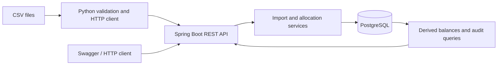

# ReconcileKit

[](https://github.com/Russwang/ReconcileKit-public/actions/workflows/ci.yml)

**An invoice and payment reconciliation backend focused on transaction correctness, safe retries and auditability.**

ReconcileKit imports invoices and payments, allocates received money to outstanding invoices, and explains what remains unpaid or unallocated. It demonstrates the engineering behind a financial workflow: exact decimal amounts, immutable source identities, concurrent allocation control, persistent idempotency and failure reporting.

Built with **Java 21, Spring Boot 4.1.1, PostgreSQL 17.11 and Python 3.13.16**. Version **0.1.1**. This is a reproducible demonstration using synthetic data, scoped to one seller/customer and GBP.

## What to review

| Capability | Design and behavior |
| --- | --- |
| Invoice/payment import | Atomic HTTP batches; duplicate detection by source and external ID; changed content conflicts |
| Manual allocation | Split a payment across invoices; reject allocations that exceed either balance |
| Explicit automatic reconciliation | Use a structured invoice source/ID target; allocate the full payment when eligible; return review reasons otherwise |
| Safe retries | Persist the original successful response; replay the same key/content; reject changed content |
| Balance and audit queries | Derive balances from allocation rows; save successful business changes and audit events in one transaction |
| CSV import | Validate the whole file before HTTP; send bounded batches; report committed, partial and unknown outcomes |
| Repeatable verification | Real PostgreSQL tests, container integration, independent SQL checks, and local backup/restore |

Start with the [architecture](docs/architecture.md), [API contract](docs/api.md) and [verification results](docs/verification.md). The business write path is in [AllocationService](backend/src/main/java/dev/reconcilekit/allocation/AllocationService.java).

## Architecture



Java owns all ledger writes. Allocation services claim the idempotency key, lock the payment and then invoices in a fixed order, read fresh allocation totals, validate both balance bounds, and commit allocations, audit records and the saved response together. Manual and automatic writers share this protocol.

## Run the demo

Requirements: Docker Engine 28+ with Compose v2, Python 3 for the core demo, and network access to the pinned images and Maven dependencies. Docker builds and runs Java; a host JDK is unnecessary for this demo. Commands below use a POSIX shell on macOS or Linux.

```bash
git clone https://github.com/Russwang/ReconcileKit-public.git
cd ReconcileKit-public
mkdir -p .runtime
python3 - <<'PY'
from pathlib import Path
import os, secrets
path = Path('.runtime/demo.env')
with path.open('x') as stream:
    os.chmod(path, 0o600)
    stream.write('DB_NAME=reconcilekit\nDB_USER=reconcilekit\n'
                 'DB_PASSWORD=' + secrets.token_hex(24) + '\nAPP_PORT=18088\n')
PY
scripts/start.sh rk-public-demo .runtime/demo.env
curl --noproxy '*' --fail http://127.0.0.1:18088/actuator/health
python3 -I scripts/core-demo.py \
  --base-url http://127.0.0.1:18088 --require-empty
```

Use a fresh project name, environment file and available port for another run. The demo requires an empty ledger. The app binds to host loopback; PostgreSQL has no published host port.

Open [Swagger UI](http://127.0.0.1:18088/swagger-ui/index.html) or [OpenAPI JSON](http://127.0.0.1:18088/v3/api-docs) once the stack is running.

The demo imports three invoices and two payments twice, verifies duplicates, allocates both payments, checks exact successful-response replay, and rejects changed or excessive requests. Its final result is:

| Record | Status | Remaining GBP |
| --- | --- | ---: |
| INV-101 | PAID | 0.00 |
| INV-102 | PAID | 0.00 |
| INV-103 | PARTIALLY_PAID | 40.00 |
| PAY-001 | FULLY_ALLOCATED | 0.00 |
| PAY-002 | FULLY_ALLOCATED | 0.00 |

There are no pending payments, even though one invoice still has an unpaid balance. [Archived 2:30 demonstration](docs/demo/reconcilekit-demo.mp4) shows captured synthetic HTTP/SQL events rendered as a silent text video. It contains references to the original development build; current public-checkout results are recorded in [verification](docs/verification.md) and this repository's Actions.

To stop the demo while retaining its data:

```bash
scripts/with-docker.sh docker compose --project-name rk-public-demo \
  --env-file .runtime/demo.env --file infra/compose.yaml down
```

## Run the checks

Backend tests require a Java 21 JDK (`JAVA_HOME`) and Docker. They use a new PostgreSQL Testcontainer:

```bash
env -u DB_URL scripts/with-docker.sh scripts/mvn.sh clean verify
```

For the CSV client and guard tests, provide **CPython 3.13.16**. On macOS arm64, `scripts/bootstrap-python.sh` supplies the pinned interpreter; elsewhere set `RK_PYTHON` to its absolute path.

```bash
export RK_PYTHON=/absolute/path/to/python3.13
scripts/setup-cli-tests.sh
scripts/test-cli.sh
scripts/python.sh -I scripts/test-check-deployment.py
scripts/python.sh -I scripts/test-recovery-guards.py
scripts/python.sh -I scripts/test-record-demo.py
```

The [CI workflow](.github/workflows/ci.yml) runs backend/client checks followed by a fresh container integration: CSV import, manual/AUTO allocation, batch conflict, actual client response loss, independent SQL invariants, container recreation, and restoration to another empty volume.

## Import a CSV

Use the [invoice](importer/templates/invoices.csv) and [payment](importer/templates/payments.csv) templates against the intended demo ledger:

```bash
scripts/import-csv.sh --kind payments \
  --file "$PWD/importer/templates/payments.csv" \
  --base-url http://127.0.0.1:18088
```

The client validates every row before sending anything, then commits separate requests of at most 1,000 rows and 2 MiB. A whole file is not one transaction. Inspect the JSON report and exit code: `0` committed, `2` invalid, `3` known error/partial result, `4` unknown outcome. Retry traces retain source identities and payloads; retries are explicit.

## Scope and tradeoffs

- Single seller/customer, GBP, positive immutable invoices/payments, synthetic examples.
- AUTO uses explicit identity. It does not infer matches from free text; each payment is a separate transaction, so a run can partially succeed.
- No authentication, role controls, multi-tenancy, correction/refund API, or verified public server deployment.
- Audit records are transactional but are not tamper-evident. Aggregate balance safety depends on all writers following the shared locking protocol.
- Tests establish the documented scenarios, including client response loss; they do not establish correctness under every possible database/network fault or commercial performance.

The implementation was developed with substantial AI assistance and reviewed through automated checks and source inspection. The repository demonstrates the software; it does not claim independent handwritten implementation, production users or measured business savings.

## Repository guide

| Path | Contents |
| --- | --- |
| `backend/` | REST API, transaction services, Flyway schema and PostgreSQL tests |
| `importer/` | Standard-library CSV/HTTP client, templates and tests |
| `infra/` | Pinned Compose configuration |
| `scripts/` | Demo, test, deployment, SQL and recovery helpers |
| `examples/` | Synthetic JSON inputs and expected core result |
| `docs/` | Architecture, API, operations and verification |

See [operations](docs/operations.md) for isolated integration, persistence and recovery checks.
