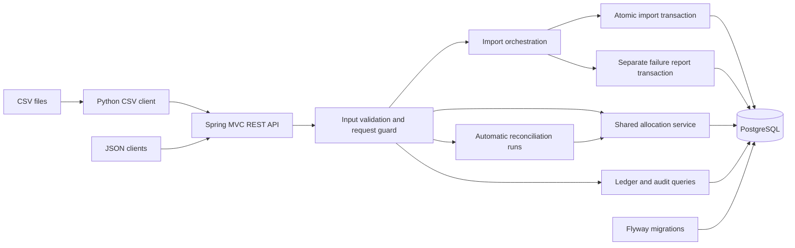

# Architecture

ReconcileKit is a single seller / single customer GBP ledger. It demonstrates how immutable invoice and payment imports, allocations, and derived balances can share a consistent transaction model. It has a REST API and a thin CSV client; authentication, a business UI, multi-tenancy, and production deployment are outside the implemented scope.

## Components

The backend uses Java 21, Spring Boot, and PostgreSQL. Business writes use `JdbcTemplate` with an explicit JDBC transaction manager. JPA invoice/payment mappings are validated against the Flyway schema. Money uses `BigDecimal` and `NUMERIC(19,2)`; the API rejects nonzero fractional pennies before database conversion.

The Python client validates the complete CSV before sending any requests, then submits bounded HTTP batches. It records private payloads and progress reports so an operator can distinguish known commits, partial completion, and unknown transport outcomes. Each request is atomic; the entire CSV is not one transaction.

## Allocation transaction

Manual and automatic allocation use the same service and `READ COMMITTED` transaction:

1. Validate and normalize the command; sort invoice IDs for manual allocation.
2. Claim an operation-scoped idempotency key. If a committed key exists, compare the request hash and replay its saved response, or reject changed content.
3. Lock the payment row, then invoice rows in ascending ID order with `SELECT ... FOR UPDATE`.
4. Read allocation sums after all parent locks are held. Reject amounts exceeding either payment or invoice remaining balances.
5. Insert allocations and the success audit event, then save the original HTTP status and response text.
6. Commit all of these facts together. An exception rolls the transaction back.

This protocol applies to every application allocation writer. A two-second database lock timeout produces a retryable failure rather than waiting indefinitely. Cross-row balance bounds depend on this shared write protocol; arbitrary external SQL does not receive the same protection from row-level database constraints.

AUTO uses an internal key derived from the payment ID. It only allocates an untouched payment in full to its explicit `(target_invoice_source, target_external_invoice_id)` when the target has enough balance. It never infers a target from free text. Each payment has its own transaction, so a run can partially succeed. A review outcome leaves no successful idempotency record and can be reconsidered after later invoice imports.

## Import transaction

An import request validates all rows before writing. Source identity defines duplicates: `(source, external_invoice_id)` or `(source, external_payment_id)`. Matching identity and normalized content count as duplicate input; conflicting content rejects the entire request without overwriting the original record.

A successful transaction saves the business rows, final import report, and success audit event together. The nontransactional orchestrator records a rejection or failure through a separate transaction after the business transaction exits. Report persistence can itself fail during a database outage; the API exposes that uncertainty instead of asserting that nothing committed.

## Data model

The six business tables are defined in [the ledger migration](../backend/src/main/resources/db/migration/V2__ledger_schema.sql).

| Table | Purpose and relationships |
|---|---|
| `import_batches` | UUID attempt identity, content hash, outcome, row errors, and final counts. |
| `invoices` | Immutable source identity, original GBP amount, issue date, and first import batch/row. |
| `payments` | Immutable source identity, original GBP amount, receipt date, optional reference and explicit target, and first import batch/row. |
| `allocations` | Append-only payment-to-invoice amounts with operation identity and `MANUAL` or `AUTO` origin; foreign keys reference both parents. |
| `idempotency_records` | `(operation_type, key)` identity, request hash, operation ID, and saved successful response. |
| `audit_events` | Operation identity, actor, event type, aggregate, detail, and timestamp. |

Balances and statuses are calculated from allocation sums; they are not stored as mutable columns. An empty pending-payment list means all payments are allocated, even if an invoice remains unpaid. Audit events are transactional records, without a tamper-evident mechanism.

## Runtime and verification boundaries

The Compose stack publishes the API on host loopback and does not publish PostgreSQL. The application runs as UID/GID 10001, with a read-only filesystem, dropped capabilities, and `no-new-privileges`. Database data lives in a named volume.

The repository includes HTTP contract tests, real PostgreSQL constraint and concurrency tests, fault/rollback tests, CSV client tests, and scripts for integration, container checks, and local backup recovery. These demonstrate the specified behavior with synthetic data; they do not establish public-host deployment, production capacity, or compliance certification.

Source entry points: [allocation service](../backend/src/main/java/dev/reconcilekit/allocation/AllocationService.java), [import orchestration](../backend/src/main/java/dev/reconcilekit/importbatch/ImportOrchestrator.java), [AUTO policy](../backend/src/main/java/dev/reconcilekit/reconciliation/AutomaticPolicy.java), and [derived ledger queries](../backend/src/main/java/dev/reconcilekit/query/LedgerQueries.java). See [API reference](api.md) for the HTTP contract.
